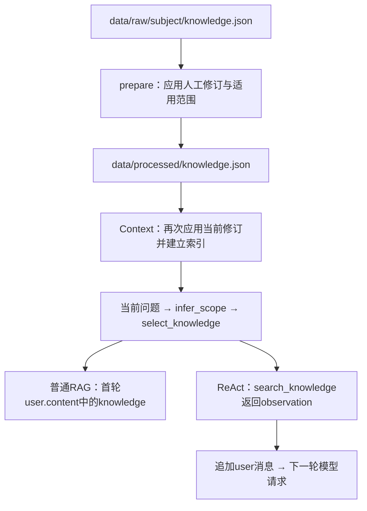

# 知识检索与上下文注入

`knowledge.json` 的1800条知识全部加载到程序内存，用于建立检索索引。每个问题通常选取最多10条知识发送给模型，选择方式是领域与数据源约束、规则指定的必需知识以及关键词评分。普通RAG和ReAct共用筛选函数，注入消息的时机不同。

## 数据与调用链



| 环节 | 代码位置 | 行为 |
|---|---|---|
| 路径 | [`paths.py`](../../src/text2query/shared/paths.py) | `RAW` 指向 `data/raw/subject`，`OUT` 指向 `data/processed` |
| 处理 | [`pipeline.prepare`](../../src/text2query/shared/data.py) | 读取原始知识，应用修订，写入处理后的知识 |
| 修订 | [`curation.apply_knowledge`](../../src/text2query/shared/curation.py) | 按ID替换文本，按ID范围附加 `declared_scope` |
| 初始化 | [`context.Context`](../../src/text2query/shared/context.py) | 读取处理知识，再应用当前修订，建立 `self.kr` |
| 筛选 | [`retrieval_context.select_knowledge`](../../src/text2query/shared/retrieval_context.py) | 必需知识补齐、关键词排序、领域过滤和坐标常量计算 |
| 注入 | [`model_pipeline.main`](../../src/text2query/non_react/pipeline.py)、[`react_pipeline.run_question`](../../src/text2query/react/pipeline.py) | 分别在初始上下文和后续工具观察中传递知识 |

人工修订来自 [`data/curated/rag_curation.json`](../../data/curated/rag_curation.json)。`knowledge_patches` 当前修订7条知识，`knowledge_scopes` 为指定ID段声明数据库与数据源。再次应用修订便于运行时使用当前配置；同一ID的修订文本会覆盖处理文件中的文本。

## 每题如何选择知识

### 1. 建立关键词索引

`Context.__init__()` 通过以下代码建立索引：

```python
self.knowledge = apply_knowledge(load(OUT / 'knowledge.json'), self.curation)
self.kr = Retriever([item['knowledge_text'] for item in self.knowledge])
```

`pipeline.tokens()` 将文本转为小写，提取英文词和数字，并将中文连续文本切成相邻双字词。`Retriever.search()` 使用BM25风格评分，综合词频、逆文档频率和文档长度排序。当前没有embedding、向量数据库或语义重排器；完整的每条知识文本作为一个检索文档。

### 2. 判断问题范围

`Context.build(question)` 先检索训练示例，再调用 `infer_scope()`：优先识别问题中明确的数据库名，随后匹配领域词及AIS等专用规则；线索不足时参考首条训练示例。结果存入 `routing`，包括 `databases`、`sources`、`confidence` 和原因。

`knowledge_domains()` 优先采用人工声明的 `declared_scope`，否则从知识文本中的库名及少量领域规则推断范围。

### 3. 加入必需知识，再补充关键词结果

`mandatory_knowledge()` 将部分业务依赖写成固定规则。例如：

| 问题领域或触发词 | 必需知识ID |
|---|---|
| 篮球BMI | 51、83、1248、1249 |
| 市净率 | 1624、1625 |
| 心理健康调查 | 186、188；年龄或国家问题另加189 |
| 游戏 | 120、121、123、1539 |
| PG招银港区航道 | 1757 |

这些ID先加入结果，原因标为 `字段/公式依赖，必须同时提供`。这是代码维护的依赖规则，没有从知识文本自动构建通用依赖图。

随后按关键词评分遍历全部知识，跳过重复ID及以下条目：

- 关键词得分不大于0。
- 声明的数据源与当前候选数据源没有交集。
- 主要数据库范围与当前问题范围没有交集；`common` 作为通用库处理。
- 路由较明确时，知识既没有数据库范围也没有数据源范围。

补充结果标为 `域内关键词召回`。总量上限为 `max(10, len(mandatory))`，当前规则下通常不超过10条；实际条数可少于10。规则指定的必需知识不经过这轮关键词得分与范围过滤。

返回记录保留 `knowledge_id`、`knowledge_text`，附加 `scope`、`retrieval_reason`，可能包含修订来源与声明范围。坐标文本会进一步转换为 `derived_constants.dms_to_decimal`，帮助模型使用正确的小数度。

相关性依赖关键词与规则，召回的每条知识不一定直接用于最终查询。范围识别较弱、同义表达缺少共同关键词或新增业务没有必需规则时，都可能影响召回。

### 4. 字典表的上位词触发

[`retrieval_context.DICT_TABLE_TRIGGERS`](../../src/text2query/shared/retrieval_context.py) 为 `common` 字典表维护“上位词→表”的映射（如 车辆→`vehicle_type_dict`、船舶→`vessel_type_dict`、驾照→`license_type_dict`、行政区划→`administrative_division`）。它解决两类问题：

- **Schema 选择**：`Context.build()` 通过 `dict_tables_for()` 把命中的字典表直接钉入 `schema`，不再依赖“只要出现 `common.*` 就展开整个 common 库”。命中表标记为 `pinned`，不受路由范围过滤。
- **字典内容注入**：`triggered_dictionary()` 把行数不超过 `TRIGGERED_DICTIONARY_MAX_ROWS`（40）的命中字典表整表回传，使“车辆数量”这类只含上位词、不含具体值（客车/货车）的问题也能看到编码映射；`dictionary_matches()` 继续负责具体字面量命中。行数多的表（如 312 行的 `administrative_division`）只走字面量匹配，避免噪声。
- **工具排序**：[`QueryTools.get_schema()`](../../src/text2query/react/tools.py) 对命中上位词或表名的表加权，使 `get_schema({"query":"车辆类型"})` 优先返回 `common.vehicle_type_dict`，而不是同后缀的其他字典表。

同时 `schema_catalog()` 保留 `)` 之后的表级选项（`ENGINE=... COMMENT='车辆类型字典'`），列表解析仍只用括号内的平衡体，避免表级注释被截断而无法被关键词检索。

## 普通RAG的注入位置

`Context.build()` 将筛选结果放在顶层 `knowledge` 字段，与Schema、字典、示例和业务规则一起返回。普通 `model` 入口序列化整个问题上下文：

```python
ctx = context.build(row['question'])
messages = [
    {'role': 'system', 'content': SYSTEM},
    {'role': 'user', 'content': json.dumps(ctx, ensure_ascii=False)},
]
```

模型读取到的知识正文位于 `messages[1].content` 中的JSON对象的 `knowledge` 数组。`SYSTEM` 要求遵守Schema、知识、单位和公式，并按知识的适用范围解释枚举。系统提示词本身也包含手工维护的业务规则。

`completion_payload()` 包装模型参数后请求 `/chat/completions`。校验失败时，程序在原对话后追加模型输出与修复反馈，保留原始知识消息；普通流程不会在每次修复时重新检索知识，最多请求4次。

两个入口差异需要注意：`baseline` 只复制最近训练示例查询，不调用模型；完整题目精确匹配 `question_corrections.json` 时，普通 `model` 入口校验后直接使用修正查询，并标注 `prediction_source=curated_question_correction`。

## ReAct的注入位置

[`react_pipeline.initial_prompt()`](../../src/text2query/react/pipeline.py) 将问题、要求、业务规则、路由、教育合并信息、字段裁定、候选表和工具说明放入初始消息。虽然内部已构建完整 `ctx`，初始消息不直接传入 `ctx['knowledge']` 数组。

模型输出动作，例如：

```json
{"action":"search_knowledge","args":{"query":"市净率 每股净资产","limit":10}}
```

[`QueryTools.search_knowledge()`](../../src/text2query/react/tools.py) 使用“原问题 + 补充检索词”，在原问题确定的路由范围内调用相同的 `select_knowledge()`。结果还包含匹配字典、字段裁定和查询辅助CTE。`limit` 默认10，允许1到12，但底层选择器通常最多返回10条；必需知识即使超过调用者指定的 `limit` 也会保留。

程序追加模型动作和观察结果：

```python
messages += [
    {'role': 'assistant', 'content': content},
    {'role': 'user', 'content': json.dumps({'observation': observation,
        'remaining_steps': max_steps - step - 1,
        'instruction': '根据工具结果选择下一步动作；错误必须解决后再次check_query。'},
        ensure_ascii=False)},
]
```

这里使用项目自定义的动作JSON，工具结果以 `user` 消息传回。下一轮模型从 `observation.knowledge` 读取知识，后续轮次保留此前消息。`check_query` 要求已调用过 `search_knowledge`，即使搜索结果为空也算完成检索。

## 示例与本地排查

题号442的问题是“查询市净率最高的前五只股票”。当前路由为MySQL的 `finance_tax` 与 `common`，召回10条知识，前两条为必需公式：

- 1624：每股净资产使用 `(total_assets * 10000) / total_shares`，并保留赛题约定口径。
- 1625：市净率为股价除以每股净资产，股价可使用最近收盘价。

在项目根目录执行以下只读检查，无需连接模型服务：

```sh
PYTHONPATH=src python3 -B - <<'PY'
import json
from text2query.shared.context import Context
from text2query.shared.paths import RAW
from text2query.shared.data import load

row = next(row for row in load(RAW / 'QA_test.json') if row['question_id'] == 442)
ctx = Context(False).build(row['question'])
print(json.dumps({'question': ctx['question'], 'routing': ctx['routing'],
                  'knowledge': ctx['knowledge']}, ensure_ascii=False, indent=2))
PY
```

已有运行中，普通模式的 `{题号}.json` 保存 `context.knowledge`；离线模式的 `{题号}.request.0.json` 保存实际首轮消息。ReAct逐题记录的 `trace` 保存动作与观察，每轮请求文件保存发送给模型的对话。完整请求和响应属于本地运行产物，Git保留的最小快照范围见[开发说明](development.md#版本管理边界)。

修改原始知识后，执行 `python3 scripts/run.py prepare`，再启动新的生成进程。`Context` 初始化后不会自动重新读取文件；修改 `knowledge_patches` 或范围声明也需要新建 `Context`。当前知识文本若被人工修订覆盖，应同时检查对应的修订配置。
